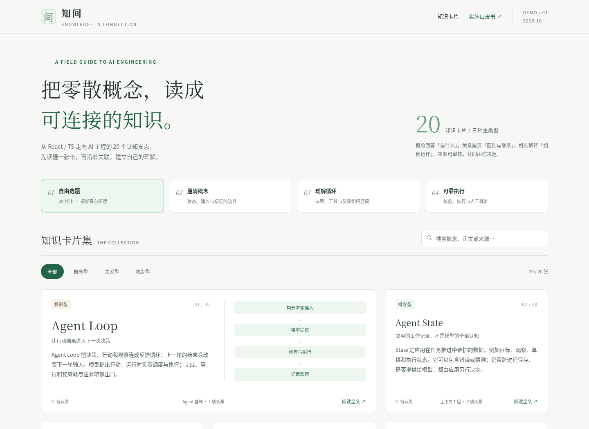

# 知间：20 张中文 AI 知识卡审阅 Demo

适用范围：React / TypeScript 工程师的 AI 工程知识阅读样本。核查日期：2026-10-21。验证状态：来源核查、内容审阅与独立 H5 渲染实测；本轮新增 Git 交付目录，未接入生产站点。

先看[桌面目录截图](screenshots/01-desktop-catalog.png)、[移动关系卡](screenshots/04-mobile-relation.png)和[移动关联预览](screenshots/05-mobile-sheet.png)，再读[完整实施白皮书](whitepaper.md)。需要交互时，下载 [H5 单文件](index.html) 并在浏览器打开。

**GitHub 的 HTML blob 页面显示源码，不是在线 H5 运行站。** 本分支没有部署；截图、Markdown 与 PDF 可在 GitHub 中直接预览。

## 下载与运行 H5

1. 打开 [index.html](index.html)，使用 GitHub 文件页的 **Download raw file** 下载原文件；手机可先保存文件，再选择支持本地 HTML / JavaScript 的浏览器打开。
2. 文件内嵌全部 20 卡、样式、交互与完整白皮书，无需 CDN、外部字体或模型接口。来源原文链接需要联网；正文与支持范围可以离线看。
3. 部分 Android 文件预览器会禁用脚本。若本地 HTML 无法交互，可在电脑下载本分支 ZIP 并解压，在仓库根目录运行以下可选本地预览命令：

```sh
python3 -m http.server 8765
```

随后在同一台设备访问 `http://127.0.0.1:8765/demos/ai-knowledge-cards-20261021/`。此地址是本地预览，不是远程手机能直接访问的站点。无需运行仓库的部署脚本，也无需安装 npm 依赖。

## 推荐试读

- **厘清概念**：State vs Context → Context Builder → Memory。
- **理解循环**：Agent Loop → Tool Calling Loop → Observation。
- **可靠执行**：Checkpoint → Idempotency → Human Approval and Resume。
- **检验边界**：Structured Output vs Business Validation；Retrieval vs Reranking。

支持全文搜索、三主类型筛选、完整阅读、桌面 hover / 键盘 focus 概览、移动底部 sheet、来源展开、可选复习答案揭示，以及关联跳转后返回原阅读位置。全部 20 卡为“待认同”，不会替用户认可。

## 白皮书与审核材料

| 材料 | 入口 |
| --- | --- |
| 完整实施计划 | [Markdown](whitepaper.md) · [12 页 PDF](whitepaper.pdf) · [阅读版 HTML](whitepaper.html) |
| 可审核内容 | [20 卡 JSON](cards.json) · [来源目录](sources.json) · [候选 TS 类型](candidate-types.ts) |
| 来源核查 | [17 项主要来源及支持范围](evidence/source-audit.md) |
| 已执行验收 | [验收报告](qa-report.md) · [299 项结果](qa-results.json) · [补充完整性检查](evidence/supplemental-checks.json) |

白皮书完整覆盖已对齐结论与撤回设计、20 卡分类和组合、内容标准、候选语义结构、统一交互、手工链接与认同、未来 AI 草稿流程、footprint 分阶段接入、里程碑、验收、风险和待决策事项。

已验证产物按原字节复用，下载名统一为小写英文。白皮书和验收报告内的初始文件名、制作目录及“当时未推送”的描述是首次制作记录；本次增加的是独立 Git 审阅交付，不代表生产协议、合并或部署获批。

## 真实截图

以下均为最终 H5 的实际 Chromium 渲染，截图文件未重新加工。



| 阅读场景 | 截图 |
| --- | --- |
| 完整机制型卡、复习与来源 | [桌面机制卡](screenshots/02-desktop-mechanism.png) |
| 桌面关联快速概览 | [Hover 预览](screenshots/03-desktop-hover-preview.png) |
| 390px 关系型卡与对照 | [移动关系卡](screenshots/04-mobile-relation.png) |
| 移动关联底部 sheet | [移动预览](screenshots/05-mobile-sheet.png) |
| 长标题、对照与代码滚动 | [移动代码卡](screenshots/06-mobile-code-and-sources.png) |
| Checkpoint 概念与副作用边界 | [移动概念卡](screenshots/07-mobile-concept.png) |
| 无匹配筛选 | [空状态](screenshots/08-empty-state.png) |
| 白皮书阅读 | [桌面](screenshots/09-whitepaper-desktop.png) · [移动](screenshots/10-whitepaper-mobile.png) |

## 验证结果与范围

已有 299 项断言通过、0 失败，覆盖 20 卡在 1440px 与 390px 下的正文顺序、来源、复习、关联、键盘、返回位置和代码内部滚动；加载后断网操作也已检查。17 项主要来源已实际打开核对；代码与案例是教学示意，没有运行真实 Agent 或业务工具。

[qa.py](qa.py) 保留原验收脚本，运行依赖环境中已有的 Python Playwright 与 Chromium，并非产品依赖。需要复查时，从本目录启动 `python3 -m http.server 8765`，另一个终端运行 `python3 qa.py`；脚本会重新生成验收结果、截图与原名 PDF，请在独立副本中运行。

真实 Android 文件打开、iOS Safari 和屏幕阅读器尚未实测。首次制作环境禁止 `file://`，因此浏览器验收使用标准本地 HTTP；不把它扩大为所有设备的离线文件兼容认证。

本目录是独立候选样本。现有文档、站点配置、依赖与部署流程均未修改；内容协议需经审阅后再制定。仓库原有 `npm test` 是失败占位，不是本 Demo 的测试套件。
